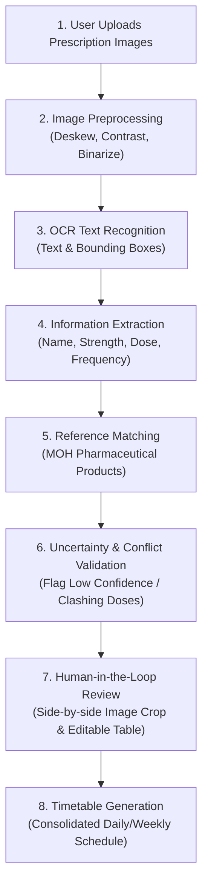

# MedLabel: AI-Based Multi-Prescription Recognition and Medication Timetable Generation

## 1. Project Title & Brief Description
**Project Title:** MedLabel: AI-Based Multi-Prescription Recognition and Medication Timetable Generation

**Domain:** Artificial Intelligence, Computer Vision, Optical Character Recognition (OCR), and Healthcare Informatics

**Brief Description:**  
**MedLabel** is an AI-assisted system designed to extract medication instructions from multiple prescription images and organize verified information into a single, consolidated medication timetable. Utilizing Optical Character Recognition (OCR), Information Extraction (IE), and reference matching against localized Malaysian pharmaceutical databases, MedLabel identifies drug names, strengths, dosages, frequencies, and administration timing. To ensure safety and prevent automation bias, the system operates under a strict **Human-in-the-Loop (HITL)** paradigm: users inspect, verify, and confirm extracted data against visual crops of the original prescription before any timetable is generated.

---

## 2. Problem Statement
Patients suffering from chronic illnesses or co-morbidities frequently receive multiple prescriptions from different healthcare providers (e.g., government hospitals, specialist clinics, and community pharmacies). Each prescription document typically uses distinct layouts, idiosyncratic medical abbreviations (e.g., *OD*, *BD*, *TDS*, *QID*, *prn*, *pc*, *om*), and varying labeling conventions. 

Manually consolidating and cross-referencing multiple prescription documents into an organized, accurate daily regimen is cognitively demanding and error-prone. Misinterpreting dosing schedules, overlooking special instructions (e.g., before or after meals), or confusing look-alike/sound-alike medications frequently leads to unintentional non-adherence, accidental overdosing, or adverse drug interactions. Existing digital OCR tools merely dump raw, unstructured text without semantic comprehension, while conventional medication tracking applications require tedious manual data entry that discourages long-term use.

---

## 3. Evidence of the Problem
1. **Global Burden of Medication Errors:** According to the World Health Organization (WHO) Global Patient Safety Challenge (*Medication Without Harm*), medication errors cause an estimated annual global cost of **\$42 billion USD**, with prescription misinterpretation and non-adherence accounting for a substantial fraction of avoidable hospital readmissions.
2. **Polypharmacy in Malaysia:** National health surveys and academic studies across Malaysian public healthcare institutions indicate that elderly and chronic disease patients are frequently prescribed five or more medications concurrently (polypharmacy). Studies in Malaysian public health clinics (Klinik Kesihatan) highlight that over **40%–50%** of elderly patients struggle with medication adherence, with confusion stemming from disparate labeling formats, bilingual instructions (Malay/English), and complex timing routines.
3. **Manual Transcription Inefficiencies & Errors:** Clinical transcription studies show that manual reconciliation of paper medication slips by patients and non-clinical caregivers carries a transcription error rate of up to **15%–30%**, with frequent omissions of frequency intervals and administration conditions.

---

## 4. Initial Related Work or Existing Approaches

### 4.1 Optical Character Recognition (OCR) Engines
- **State-of-the-art Engines:** PaddleOCR, EasyOCR, Google ML Kit Text Recognition, and Tesseract.
- **Capability:** Capable of localizing bounding boxes and extracting text tokens from scanned documents and smartphone photos.
- **Limitation:** General-purpose OCR models lack domain-specific medical lexicons. Blurred labels, glare on medicine packaging, curved bottle labels, and compressed pharmacy printing frequently lead to character substitutions (e.g., misreading `10mg` as `100mg` or `BD` as `8D`).

### 4.2 Prescription Information Extraction Research
- **Biomedical Entity Extraction:** Models using BioBERT, SciBERT, and ClinicalBERT have demonstrated success in identifying pharmaceutical entities from clinical narratives and Electronic Health Records (EHR).
- **Public Prescription Datasets:** Research datasets such as the *Mendeley Prescription Dataset* (Bangladesh) explore OCR and text parsing for prescription slips.
- **Limitation:** Most benchmark datasets focus on clinical notes or foreign prescription formats. They do not reflect the bilingual instructions (Malay/English) and standardized dispensing labels used by the Malaysian Ministry of Health (KKM) and private Malaysian pharmacy chains.

### 4.3 Medication Scheduling & Adherence Applications
- **Existing Solutions:** Mobile applications like *Medisafe*, *MyTherapy*, and *CareZone*.
- **Capability:** Provide notification alarms, pill tracking, and adherence logs.
- **Limitation:** These applications depend entirely on tedious, error-prone manual data entry or simple barcode scanning against proprietary Western drug databases. They lack automated visual ingestion from multiple disparate prescription sheets.

---

## 5. Engineering Gap or Limitation
While OCR technology and medication reminder apps exist independently, **a critical engineering gap exists in integrating end-to-end multi-image OCR, bilingual medical information extraction, national pharmaceutical grounding, and safety-critical conflict detection into a unified, traceable pipeline.**

Key engineering challenges and limitations addressed by MedLabel include:
1. **Unstructured & Bilingual Layout Parsing:** Transforming unstructured text containing mixed Malay and English instructions (e.g., *"1 biji 2 kali sehari selepas makan"* vs. *"1 tab BD pc"*) into structured schema (`{medication, strength, dose, frequency, timing}`).
2. **Pharmaceutical Reference Grounding:** Mitigating OCR errors by matching extracted text against the official Malaysian Ministry of Health drug catalog.
3. **Traceability and Human-in-the-Loop (HITL) Safeguards:** Preventing automation bias by directly pairing each extracted field with its original bounding-box image crop, ensuring no timetable is compiled without explicit user verification.
4. **Schedule Synthesis & Conflict Detection:** Detecting duplicate therapies (same active ingredient across multiple slips) and resolving overlapping administration times into an intelligible schedule.

---

## 6. Initial Project Objectives
1. **OCR & Text Digitization Pipeline:** Develop and implement an OCR pipeline tailored for multi-prescription and medicine label images that handles varying image qualities, lighting, and orientations.
2. **Medication Entity Extraction & Normalization:** Implement an information extraction module to parse drug names, dosages, strengths, frequencies, and durations, grounding extracted drugs against the Malaysian pharmaceutical reference dataset.
3. **Uncertainty & Conflict Detection Module:** Build validation algorithms to automatically flag ambiguous text, missing dosage fields, abnormal frequencies, and potential active-ingredient duplication across uploaded prescriptions.
4. **Interactive Human-in-the-Loop UI & Timetable Generation:** Create an intuitive Streamlit interface allowing users to inspect visual crops, correct extraction errors, and generate a consolidated, conflict-checked medication timetable.
5. **Empirical Evaluation:** Rigorously evaluate system performance on Character Error Rate (CER), Word Error Rate (WER), Information Extraction Precision/Recall/F1, and timetable generation correctness.

---

## 7. Target Users
- **Chronic Disease & Polypharmacy Patients:** Individuals managing complex, multi-drug daily regimens who need a clear, unified schedule.
- **Caregivers & Family Members:** Individuals responsible for sorting, scheduling, and administering medications for elderly or dependent family members.
- **Community Healthcare Workers & Pharmacists:** Healthcare professionals who assist patients with medication reconciliation and adherence counseling.

---

## 8. Proposed Data Sources
1. **Malaysian Pharmaceutical Products Dataset (Primary Ground Truth Catalog):**
   - **Source:** Ministry of Health Malaysia (MOH) Open Data Catalogue
   - **URL:** [https://data.moh.gov.my/data-catalogue/pharmaceutical_products](https://data.moh.gov.my/data-catalogue/pharmaceutical_products)
   - **Usage:** Serves as the authoritative master reference for drug brand names, generic active ingredients, registered dosage forms, and strengths in Malaysia.
2. **Prescription Image Dataset (Initial Benchmarking):**
   - **Source:** Mendeley Data (Prescription Image Dataset)
   - **URL:** [https://data.mendeley.com/datasets/k62rfd23kz/2](https://data.mendeley.com/datasets/k62rfd23kz/2)
   - **Usage:** Provides an initial set of real-world printed and handwritten prescription images for preliminary OCR evaluation and bounding box validation.
3. **Curated Synthetic & De-Identified Malaysian Prescription Dataset:**
   - **Source:** Synthetically generated and de-identified local prescription labels mimicking KKM hospital dispensing slips and major retail pharmacy labels (e.g., Caring, Guardian, Big Pharmacy).
   - **Usage:** Used for training, prompt design, and evaluating bilingual extraction and timetable accuracy without compromising patient privacy.

---

## 9. Weekly Progress Table

| Week | Phase / Milestone | Planned Tasks & Deliverables | Status |
| :--- | :--- | :--- | :--- |
| **Week 1** | **Project Inception & Scoping** | • Formulate problem statement, evidence, objectives, and engineering gap.<br/>• Establish repository structure (`docs/`, `src/`, `data/`, `notebooks/`, `evaluation/`, `prompts/`).<br/>• Complete observation sheet (`docs/week1_observation_sheet.md`) and system map.<br/>• Build initial Streamlit app skeleton (`app.py`) for multi-image upload & preview.<br/>• Publish comprehensive project `README.md`. | **Completed** |
| **Week 2** | **Data Preparation & Reference Cataloging** | • Ingest and preprocess MOH Malaysian Pharmaceutical Products dataset.<br/>• Curate synthetic and de-identified test prescription images in `data/`.<br/>• Define annotation schemas for medication name, strength, dosage, and frequency. | Pending |
| **Week 3** | **OCR Pipeline Exploration & Benchmarking** | • Benchmark candidate OCR engines (PaddleOCR, EasyOCR, Tesseract) on sample labels.<br/>• Implement preprocessing routines (deskewing, binarization, adaptive thresholding).<br/>• Evaluate baseline CER and WER in `evaluation/`. | Pending |
| **Week 4** | **Information Extraction (IE) - Rule-based & NER** | • Implement regex and clinical NLP parsers for Malaysian dosing frequencies (OD, BD, TDS, QID, PRN).<br/>• Extract drug names, dosage amounts, and administration routes in `src/extraction.py`.<br/>• Build prompt templates in `prompts/` for LLM-assisted zero-shot parsing. | Pending |
| **Week 5** | **Pharmaceutical Reference Grounding** | • Implement fuzzy string matching and phonetic matching against MOH registered drugs.<br/>• Map extracted brand names to generic entities and validate plausible strengths.<br/>• Measure reference matching precision and recall. | Pending |
| **Week 6** | **Uncertainty & Conflict Detection** | • Implement safety checks in `src/validation.py` for missing fields or low OCR confidence.<br/>• Develop duplicate drug detection and conflicting frequency detection.<br/>• Generate actionable warning flags for end-user review. | Pending |
| **Week 7** | **Interactive Verification Interface (HITL)** | • Build side-by-side Streamlit verification interface with synchronized image crops.<br/>• Enable interactive data editing via `st.data_editor`.<br/>• Implement confirmation gates preventing schedule generation before verification. | Pending |
| **Week 8** | **Timetable Generation Algorithm** | • Develop schedule consolidation logic in `src/timetable.py`.<br/>• Map frequencies to daily time slots (Morning, Afternoon, Evening, Bedtime).<br/>• Incorporate meal condition constraints (before/after food). | Pending |
| **Week 9** | **Export & Visual Schedule Rendering** | • Implement timetable visualizations (weekly grid, printable PDF/calendar export).<br/>• Conduct end-to-end integration tests connecting upload, OCR, verification, and schedule display. | Pending |
| **Week 10** | **System Evaluation & Error Analysis** | • Execute rigorous evaluation across test dataset using `evaluation/evaluation_plan.md`.<br/>• Compute extraction F1-score, CER/WER, and timetable correctness metrics.<br/>• Perform failure mode analysis on low-quality prescription images. | Pending |
| **Week 11** | **User Testing & Feedback Refinement** | • Conduct user-testing sessions with sample personas (caregivers, general users).<br/>• Refine UI/UX based on usability feedback and error recovery observations. | Pending |
| **Week 12** | **Final System Optimization & Documentation** | • Optimize pipeline latency, caching, and model resource utilization.<br/>• Finalize technical report, user guide, and demo assets.<br/>• Prepare final project presentation and release build. | Pending |

---

## 10. System Architecture & Proposed Workflow



---

## 11. Repository Structure

```text
ai-engineering-MedLabel/
│
├── README.md                           # Main project documentation
├── app.py                              # Streamlit interactive application
├── requirements.txt                    # Project Python dependencies
├── .gitignore                          # Git ignored patterns
│
├── docs/                               # Project documentation & milestone records
│   ├── week1_observation_sheet.md      # Week 1 observation findings
│   ├── week1_project_scope.md          # Week 1 project scope specification
│   ├── observation_sheet.md            # Working observation sheet
│   └── system_map.md                   # System workflow map
│
├── data/                               # Dataset samples & ground truth references
│   ├── README.md                       # Data governance and usage guidelines
│   └── .gitkeep
│
├── src/                                # Core functional modules
│   ├── ocr.py                          # Image preprocessing & OCR text recognition
│   ├── extraction.py                   # Medication information extraction logic
│   ├── validation.py                   # Uncertainty, conflict & validation logic
│   └── timetable.py                    # Timetable consolidation & generation logic
│
├── notebooks/                          # Experimental and exploratory notebooks
│   └── .gitkeep
│
├── evaluation/                         # Evaluation scripts and metric plans
│   ├── evaluation_plan.md              # Formal evaluation plan and metrics
│   └── .gitkeep
│
└── prompts/                            # Structured prompt templates for extraction
    └── .gitkeep
```

---

## 12. Getting Started

### Prerequisites
- Python 3.10+ (Python 3.11 / 3.12 / 3.14 compatible)
- Virtual environment tool (`venv` or `conda`)

### Installation
1. Clone the repository:
   ```bash
   git clone https://github.com/muhdilham1602-max/MedLabel.git
   cd MedLabel
   ```
2. Create and activate a virtual environment:
   ```bash
   python -m venv .venv
   # Windows:
   .venv\Scripts\activate
   # macOS/Linux:
   source .venv/bin/activate
   ```
3. Install dependencies:
   ```bash
   pip install -r requirements.txt
   ```

### Running the Application
Launch the interactive Streamlit prototype:
```bash
streamlit run app.py
```
*(Or `python -m streamlit run app.py`)*

---

## 13. Responsible AI, Ethics & Privacy
- **Human-in-the-Loop Safeguards:** AI is never used as an autonomous prescriber or medical authority. Generated timetables are strictly derivative of human-verified inputs.
- **Patient Data Privacy:** No identifiable health data (PII) is stored or transmitted without de-identification. Sample data stored in this repository uses synthetic or public research datasets only.
- **Traceability:** Every consolidated dosage entry retains bidirectional traceability back to the source prescription image crop.

---

## 14. Disclaimer
*MedLabel is an academic prototype developed for research and educational purposes only. It is not certified as a medical device and must not replace professional judgment, clinical advice, diagnosis, or treatment provided by registered physicians and pharmacists.*
