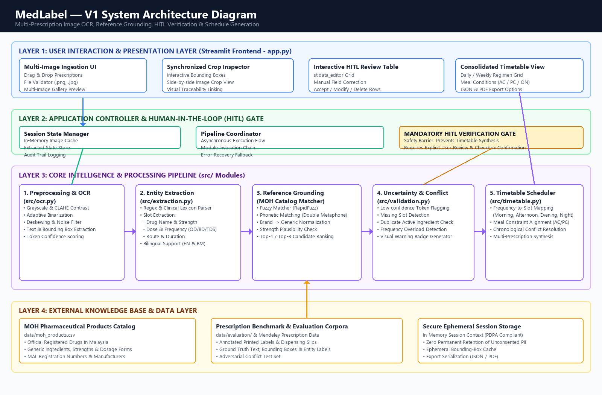

# Week 2 — V1 Architecture & Architecture Decision Records (ADR)

**Project:** MedLabel (AI-Based Multi-Prescription Recognition and Medication Timetable Generation)  
**Document Version:** 1.0  
**Date:** October 28, 2026  
**Author:** MedLabel Engineering Team  

---

## 1. System Architecture Overview

MedLabel is architectured around a **modular, traceable, human-in-the-loop (HITL) pipeline**. Rather than treating prescription understanding as an unconstrained black-box vision-to-text task, the architecture decouples optical text recognition, semantic clinical extraction, national drug database grounding, safety validation, and timetable compilation.

### 1.1 Architecture Diagram
The high-level structural design of MedLabel V1 is illustrated below:

> **Draw.io Source Diagram:** An editable version is provided in [docs/week2_architecture_v1.drawio](week2_architecture_v1.drawio), which can be opened and edited directly in [draw.io (diagrams.net)](https://app.diagrams.net).

### 1.2 Multi-Layer Organization
1. **Layer 1: User Interaction & Presentation Layer (`app.py` via Streamlit)**
   - Manages prescription file ingestion (`PNG`, `JPG`, `JPEG`).
   - Renders interactive split-screen views showing original image crops alongside extracted fields.
   - Provides an editable table (`st.data_editor`) for user correction.
   - Displays the consolidated daily/weekly timetable with meal-timing icons and export buttons.
2. **Layer 2: Application Controller & HITL Guardrail**
   - Coordinates asynchronous pipeline execution and manages in-memory session states.
   - Enforces the **Mandatory HITL Verification Gate**: completely blocks timetable generation until the user verifies all extracted items and explicitly checks confirmation.
3. **Layer 3: Core Intelligence & Processing Pipeline (`src/`)**
   - **OCR & Preprocessing (`src/ocr.py`):** Grayscale conversion, CLAHE contrast enhancement, deskewing, and bounding-box tokenization with confidence scores.
   - **Entity Extraction (`src/extraction.py`):** Deterministic regex and clinical slot-filling parser supporting both Latin abbreviations (`TDS`, `BD`, `OD`) and Malay instructions (`3 kali sehari selepas makan`).
   - **Reference Grounding (`MOH Catalog Matcher`):** RapidFuzz and Double Metaphone matching against registered Malaysian Ministry of Health products.
   - **Uncertainty & Conflict Detection (`src/validation.py`):** Flags low-confidence tokens, missing dosage slots, and duplicate active ingredients across uploaded prescriptions.
   - **Timetable Scheduler (`src/timetable.py`):** Chronological bucket mapping (Morning, Afternoon, Evening, Night) with meal condition grouping (Before/After Food).
4. **Layer 4: External Knowledge Base & Ephemeral Data Layer (`data/`)**
   - Official Malaysian Ministry of Health (MOH) Pharmaceutical Products Catalog (`data/moh_products.csv`).
   - Curated evaluation test split corpora with ground-truth entity labels (`data/evaluation/`).
   - Ephemeral session cache complying with the Malaysian Personal Data Protection Act (PDPA 2010).

---

## 2. Architecture Decision Records (ADRs)

### ADR-001: Modular Pipeline vs. Monolithic End-to-End Multimodal VLM

- **Status:** **Accepted**
- **Context:**  
  Recent advancements in Multimodal Vision-Language Models (VLMs like GPT-4o, Claude 3.5 Sonnet, or Gemini 1.5 Pro) allow direct image-to-schedule conversion via end-to-end prompts. However, prescriptions are safety-critical documents containing high-risk pharmacological dosages where hallucinations, silent omissions, or unverified approximations carry fatal risks.
- **Decision:**  
  Implement a **decoupled modular pipeline** (Preprocessing $\rightarrow$ OCR $\rightarrow$ Slot-filling Extraction $\rightarrow$ Reference Grounding $\rightarrow$ Conflict Detection $\rightarrow$ Timetable Scheduler) rather than a single end-to-end black-box prompt.
- **Consequences:**  
  - *Positive:* Every intermediate step produces verifiable, inspectable artifacts (bounding box coordinates, token confidence scores, candidate matching distance). Enables unit testing of each module independently. Significantly lower operating cost and latency.
  - *Negative:* Errors in upstream OCR can propagate to downstream extraction if not caught by the uncertainty validator.
- **Alternatives Considered:**  
  - *Monolithic VLM Prompting:* Rejected due to lack of token-level bounding box traceability, risk of unflagged hallucinations, high latency, and high cloud inference costs.

---

### ADR-002: Mandatory Human-in-the-Loop (HITL) Validation Gate with Visual Bounding-Box Traceability

- **Status:** **Accepted**
- **Context:**  
  Automation bias causes users to uncritically trust automated schedules. In healthcare, an error in reading `10mg` as `100mg` or `BD` as `QID` can result in severe overdose. The system must establish a non-negotiable verification mechanism before producing actionable patient schedules.
- **Decision:**  
  The application enforces a hard, programmatic **HITL Verification Gate**. The timetable generation module is disabled until:
  1. All low-confidence or conflicting items are reviewed by the user.
  2. The user is presented with a synchronized crop of the original prescription image matching the active row.
  3. The user explicitly checks an acknowledgment confirming that all items match the physical prescription labels.
- **Consequences:**  
  - *Positive:* Drastically mitigates automation bias and clinical liability; ensures 100% human accountability; guarantees full patient awareness.
  - *Negative:* Introduces slight interaction friction (requires 30–60 seconds of user review per prescription batch).
- **Alternatives Considered:**  
  - *Fully Autonomous "One-Click" Generation:* Rejected due to unacceptable clinical safety risks and ethical non-compliance with WHO patient safety recommendations.

---

### ADR-003: Malaysian MOH Drug Reference Grounding via Hybrid Fuzzy & Phonetic Matching

- **Status:** **Accepted**
- **Context:**  
  OCR engines frequently introduce character substitutions (e.g., `0` for `O`, `l` for `1`, `rn` for `m`). Furthermore, patients receive both generic drugs and commercial brand names. We need to normalize extracted drug strings to official registered entities in Malaysia.
- **Decision:**  
  Ground extracted drug entities against the open **Malaysian Ministry of Health (MOH) Pharmaceutical Products Dataset** using a two-stage hybrid matching algorithm:
  1. *Phonetic Filtering:* Double Metaphone encoding to retrieve phonetically similar drug candidates.
  2. *Token-Sort Levenshtein Distance (RapidFuzz):* Re-ranks candidates and computes a confidence score ($0.0 - 1.0$). If confidence is below $0.80$, the top 3 candidates are presented to the user for selection.
- **Consequences:**  
  - *Positive:* Robust against typical OCR typographical noise; standardizes brand and generic naming conventions; automatically identifies dosage forms and strengths.
  - *Negative:* Requires bundling or caching the MOH dataset (approx. 20,000–30,000 registered product entries, requiring efficient indexing).
- **Alternatives Considered:**  
  - *Exact String Matching:* Rejected because minor OCR noise causes 100% lookup failure.
  - *Western Databases (RxNorm / FDA NDC):* Rejected because product names, brand names, and registered dosage strengths in Malaysia differ substantially from US/European registries.

---

## 3. Architectural Trade-offs Analysis

| Architectural Dimension | Approach A (Chosen) | Approach B (Alternative) | Justification for Choice |
| :--- | :--- | :--- | :--- |
| **Extraction Paradigm** | **Modular Pipeline** (OCR + Regex/NLP + Matcher) | **End-to-End Multimodal VLM** | Modularity provides strict auditability, token-level coordinates, determinism, and zero hallucination risk. |
| **System Workflow** | **Mandatory Human Validation** | **Zero-Click Instant Output** | In medical adherence, accuracy and safety override convenience. Mitigates automation bias. |
| **Reference Grounding** | **Local MOH Dataset (RapidFuzz)** | **Online LLM Knowledge Retrieval** | Localized MOH dataset provides official Malaysian regulatory truth without external API latency or privacy leaks. |
| **Data Privacy Architecture** | **In-Memory Ephemeral Session** | **Persistent Cloud Database** | Minimizes compliance complexity under PDPA 2010 by avoiding permanent storage of unconsented patient medical slips. |

---

## 4. Traceability Matrix

This matrix establishes end-to-end traceability between project requirements, architectural components, source code files, and evaluation criteria:

| Requirement ID | Requirement Summary | Architectural Layer | Primary Implementation File | Verification & Evaluation Metric |
| :--- | :--- | :--- | :--- | :--- |
| **FR-01** | Multi-image file ingestion | Layer 1 (Presentation) | [`app.py`](../app.py) | Upload stress testing & MIME validation |
| **FR-02** | Image preprocessing & deskewing | Layer 3 (Pipeline) | [`src/ocr.py`](../src/ocr.py) | Image contrast score & CER improvement |
| **FR-03** | OCR text & bounding box extraction | Layer 3 (Pipeline) | [`src/ocr.py`](../src/ocr.py) | CER $\le 10\%$, WER $\le 18\%$ |
| **FR-04** | Entity extraction (Name, Dose, Freq) | Layer 3 (Pipeline) | [`src/extraction.py`](../src/extraction.py) | Extraction F1-Score $\ge 85\%$ |
| **FR-05** | Bilingual translation (Malay/English) | Layer 3 (Pipeline) | [`src/extraction.py`](../src/extraction.py) | Frequency & timing mapping accuracy $\ge 95\%$ |
| **FR-06** | MOH Reference Grounding | Layer 3 & Layer 4 | [`src/extraction.py`](../src/extraction.py) & `data/` | Top-1 Accuracy $\ge 80\%$, Top-3 $\ge 90\%$ |
| **FR-07** | Uncertainty confidence scoring | Layer 3 (Pipeline) | [`src/validation.py`](../src/validation.py) | Uncertainty Recall $\ge 90\%$ |
| **FR-08** | Duplicate active ingredient check | Layer 3 (Pipeline) | [`src/validation.py`](../src/validation.py) | Conflict Detection Rate $\ge 95\%$ |
| **FR-09** | Visual bounding crop inspection | Layer 1 (Presentation) | [`app.py`](../app.py) | Bounding box spatial intersection over union (IoU) |
| **FR-10** | Interactive data grid editing | Layer 1 (Presentation) | [`app.py`](../app.py) | User edit latency $< 200\text{ ms}$ |
| **FR-11** | Consolidated timetable generation | Layer 3 (Pipeline) | [`src/timetable.py`](../src/timetable.py) | Schedule Slot Accuracy $\ge 92\%$ |
| **FR-12** | Structured JSON / summary export | Layer 1 (Presentation) | [`app.py`](../app.py) & [`src/timetable.py`](../src/timetable.py) | Schema validation against target JSON spec |
| **NFR-1** | Latency $< 5\text{s}$ per image | Cross-cutting | [`app.py`](../app.py), [`src/ocr.py`](../src/ocr.py) | Benchmarked end-to-end turnaround time |
| **NFR-2** | Usability & Elderly Accessibility | Layer 1 (Presentation) | [`app.py`](../app.py) | System Usability Scale (SUS) $\ge 70$ |
| **NFR-3** | Mandatory HITL Verification Gate | Layer 2 (Orchestration)| [`app.py`](../app.py), [`src/validation.py`](../src/validation.py) | 0% unverified schedule generation |
| **NFR-4** | End-to-end coordinate audit trail | Cross-cutting | [`src/extraction.py`](../src/extraction.py) | 100% bidirectional traceability |
| **NFR-5** | Modularity & decoupling | Architecture | [`src/`](../src/) package design | Code maintainability index & unit test coverage |
